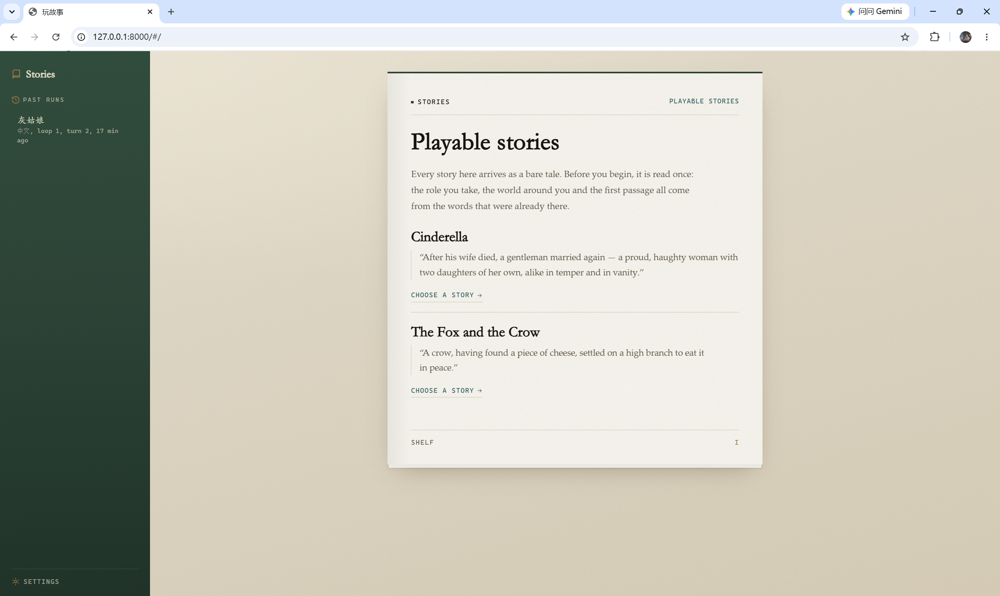
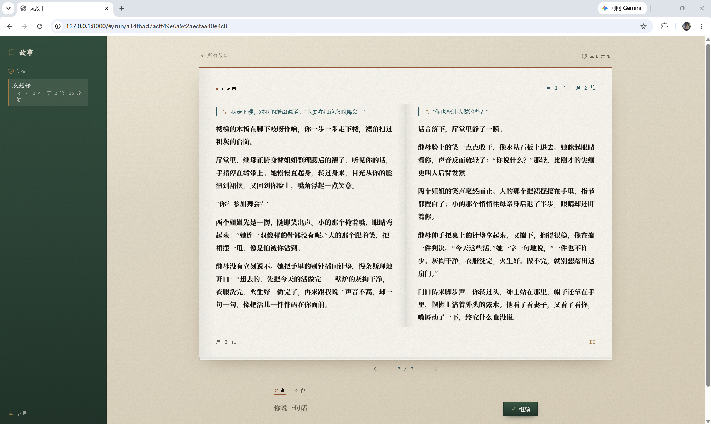

# Fox-and-Crow

A working experiment in interactive narrative: can a generative LLM agent be the
storyteller of a text game whose story is genuinely changed by what the player
writes?

- Repository: <https://github.com/666feiyu666/Fox-and-Crow>
- Runnable engine: [`storyteller/`](storyteller/README.md) — run it, test it
- Engine architecture: [`storyteller/ARCHITECTURE.md`](storyteller/ARCHITECTURE.md)
- Cases: [`cases/fox-and-crow`](cases/fox-and-crow/README.md) (Aesop),
  [`cases/cinderella`](cases/cinderella/README.md) (Perrault)

## What it looks like

The shelf. Every tale arrives as bare text; before you begin it is read once, and
that reading becomes the role you take, the world around you and the opening.



A turn in progress, on facing pages: what you wrote — and what it set off — on the
left, the storyteller's answer on the right. Here the player has just told her
stepmother she is going to the ball.



The interface is part of the apparatus rather than decoration. It is set as a book
instead of a chat window: the shelf lists each tale, the telling language is chosen
before a run opens, past runs sit in a rail and can be reopened or deleted, and the
interface language switches independently of the story's. A run is written to disk
after every committed turn, so play can be picked up again later.

There is no hosted instance. The engine runs locally and nothing is deployed from
this repository.

## Research questions

The project tests how a generative model enters a text game and becomes playable. It treats
interactive narrative as the thing under study. Three questions organise the work.

1. **Agency.** Can a player's typed line — something said, or something
   attempted — be shown to change where the story goes, judged turn by turn,
   instead of selecting among pre-authored options?
2. **Constraint.** What structure keeps that freedom legible to the player?
3. **Grounding.** Can the model's freedom stay answerable to a source, so that
   the world remains the supplied tale's world while the outcome stops being the
   tale's outcome?

## What "playable" means here

Playability is defined narrowly and operationally: the player writes one line to
say or one action to attempt, that text is the only input, and what it changes is
decided *after* it is written rather than chosen *before* from a list. There is no
script, no branch tree, no clock, no score, and no rulebook enforced on top of the
world the tale implies. A turn is playable when what the player wrote shows up in
what happens next.

## How the generative side is built

The design effort sits on the model side, and LangGraph is what makes the model
playable rather than merely talkative.

- **Four agent stages.** `understand` reads the supplied tale and derives the story
  space — source anchors, situation, initial facts, fixed constraints, uncommitted
  possibilities, the loop's authored convention and the writing voice; `judge`
  decides what a player's line changes; `writer` turns that ruling into the passage
  the player reads; `reader-review` checks direction, coherence and voice before
  publication and can send one bounded repair back to the judge or the writer.
- **Two graphs.** Preparation (`understand → write_opening`) runs once per case,
  language and input fingerprint, and is cached as reviewable JSON beside the case.
  A turn (`judge → write → review`, with conditional edges back for repair) commits
  state, knowledge and the ruling together, or leaves the session untouched.
- **Grounding and state.** Every source claim carries an exact excerpt, checked
  against the tale. Facts are keyed, so an object has one current holder instead of
  accumulating contradictions; knowledge is per actor; a loop resets the world and
  keeps only the protagonist's memories.

## What the project contributes

- A runnable apparatus in which agency is exercised and inspected rather than
  assumed: two familiar short tales, a player who types freely, an agent that must
  adjudicate what that typing means.
- A constraint design — the loop — that turns "just follow the story" into an
  experienceable failure, and moves the question "has the loop been broken?" out of
  branching code and into judgement.
- An agent-side architecture for keeping generation playable and answerable to a
  source: staged skills, quoted source anchors, keyed facts and per-actor knowledge,
  content review with a bounded repair budget, and cached preparation with an
  explicit invalidation fingerprint.

## Status

Under active development; both cases are test inputs, and the repository is not
evidence that the agent solution is complete or validated. Passing tests describe
implementation behaviour only. They do not establish narrative quality, agent
capability, author utility, player agency, or research validity.

## Run it

```bash
cd storyteller
python -m venv .venv
.venv/bin/python -m pip install -r requirements.txt   # Windows: .venv\Scripts\python -m pip install -r requirements.txt
cp .env.local.example .env.local                      # then set DEEPSEEK_API_KEY
.venv/bin/python backend/server.py                    # Windows: .venv\Scripts\python backend\server.py
```

Then open `http://127.0.0.1:8000`. The first session in a language makes the extra
model calls that derive the case from the tale; later sessions reuse the cached
reading. [`storyteller/README.md`](storyteller/README.md) covers cases, tests and
the cache; [`storyteller/ARCHITECTURE.md`](storyteller/ARCHITECTURE.md) covers the
graphs, the ruling contract and the writer's boundary.
